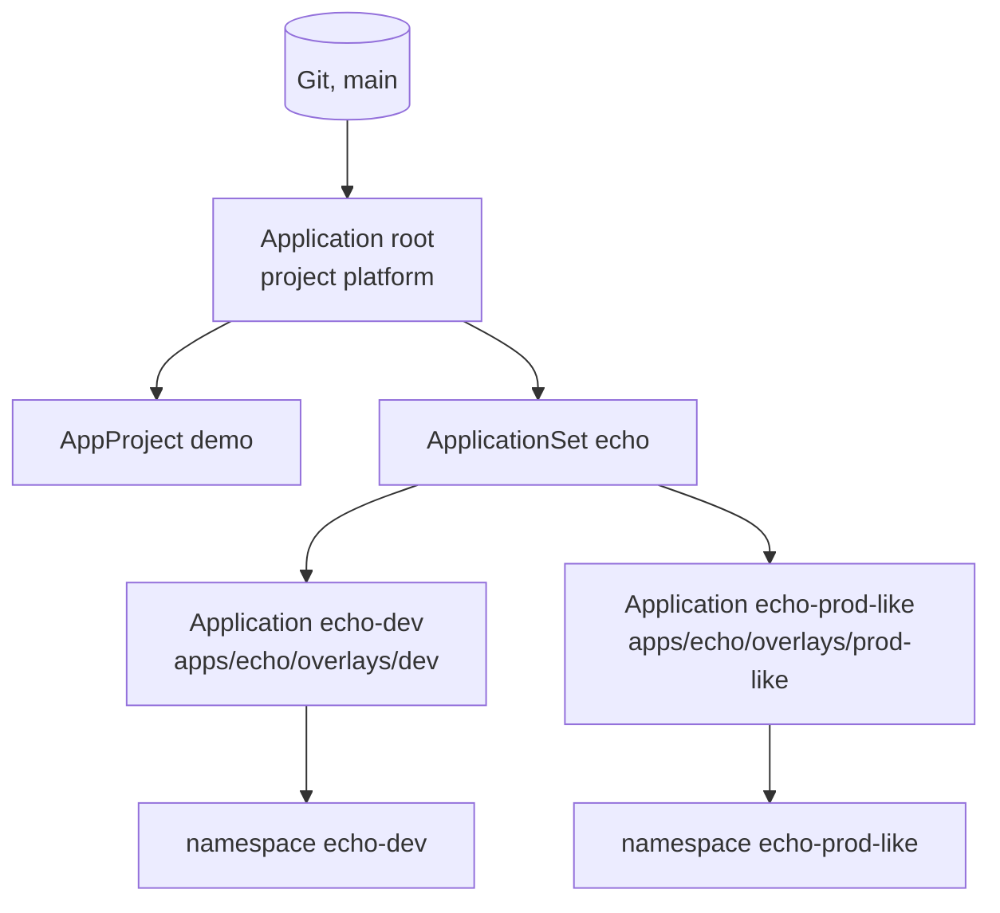
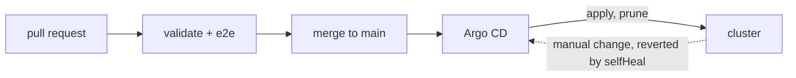

# gitops-argocd

[](https://github.com/Walaskien/gitops-argocd/actions/workflows/validate.yaml)
[](https://github.com/Walaskien/gitops-argocd/actions/workflows/e2e.yaml)

A small app deployed to two environments by Argo CD, with Git as the only way to change it. The repo has the app-of-apps layout, the manifests, the checks that run on every pull request, and an end-to-end job that boots a cluster and tries to break the setup from both sides.

## The problem

Somebody scales a Deployment by hand during an incident, edits an image tag with `kubectl set image` to try a fix, deletes a NetworkPolicy that was "in the way". Nobody writes it down. A week later the cluster does not match the manifests in the repo, the next deploy overwrites the fix or, worse, keeps it, and nobody can say which of the two is right.

The setup here makes Git the answer. Argo CD compares the cluster with the repo all the time and, with `selfHeal` and `prune` on, undoes whatever is not in Git. A version change is a pull request, a rollback is a `git revert`.

## How it works



`bootstrap/` is applied by hand once and contains the root Application. From then on everything under `argocd/` (the `demo` project and an ApplicationSet that generates one Application per environment) is managed from Git too. Each environment is a Kustomize overlay on one base with its own namespace, version, replica count and message.



The app is [podinfo](https://github.com/stefanprodan/podinfo), because it reports its own version over HTTP, which makes "did the new version arrive" a `curl`. The Deployment has readiness and liveness probes, requests and a memory limit, runs as non-root with a read-only root filesystem and no capabilities, and the namespaces enforce the `restricted` pod security level. A default-deny NetworkPolicy sits next to one that allows traffic from the same namespace only.

## Quick start

You need a disposable cluster (kind is fine) and `kubectl`.

```sh
kind create cluster --name gitops
kubectl create namespace argocd
kubectl apply -n argocd --server-side --force-conflicts \
  -f https://raw.githubusercontent.com/argoproj/argo-cd/v3.3.18/manifests/install.yaml
kubectl -n argocd rollout status deploy/argocd-server

kubectl apply -f bootstrap/
kubectl -n argocd get applications
```

`--server-side` is needed because the ApplicationSet CRD is too large for a client-side apply.

The manifests point at `https://github.com/Walaskien/gitops-argocd.git`. To make your own changes, fork the repo and replace that URL in the four places that mention it (`grep -rn 'gitops-argocd.git' bootstrap argocd`).

Things to try once both apps are Synced and Healthy:

```sh
# drift: the replica count goes back to 1 on its own
kubectl -n echo-dev scale deploy/echo --replicas=3
kubectl -n echo-dev get deploy echo -w

# a version change: edit newTag in apps/echo/overlays/dev/kustomization.yaml,
# push (or open a PR), and watch
kubectl -n argocd get app echo-dev -w
```

How a version change is supposed to travel is in [docs/change-flow.md](docs/change-flow.md), how to take one back in [docs/rollback.md](docs/rollback.md).

Checks without a cluster: `scripts/install-tools.sh ~/bin` (linux amd64) or any kustomize, kubeconform and conftest of your own, then `make venv validate`. `make e2e` runs the end-to-end script against a kind cluster it creates and deletes, using its own kubeconfig so your current context is left alone.

## Verified

Run on my machine while writing this:

- `scripts/validate.sh` passes with kustomize v5.8.3, kubeconform v0.8.0, conftest v0.70.1 and yamllint 1.37.1. That is yamllint in strict mode, 20 Rego unit tests, the four Argo CD objects and the rendered dev (5 objects) and prod-like (6 objects) overlays validated against Kubernetes 1.34 schemas and the Argo CD CRD schemas, and the policies run on the rendered output.
- The policies do reject what they should: with the dev tag set to `latest` and the default-deny policy removed, conftest fails on both.
- shellcheck 0.10.0 on the scripts and actionlint 1.7.7 on the workflows are clean.
- The test git remote image builds, and a stock git client can push, clone, fetch, revert and `ls-remote` against it over HTTP (docker network only, no published ports).
- podinfo starts with a non-root user, read-only filesystem and all capabilities dropped, and answers `/`, `/healthz` and `/readyz`.

On GitHub Actions (runs on `main`, 11 Nov 2026):

- `validate` runs the same script as above on every pull request and push to main. It is green, the job takes about 15 seconds.
- `e2e` creates a kind cluster (kind v0.31.0, Kubernetes 1.34.3), installs Argo CD v3.3.18 and applies `bootstrap/`. It waits for root, `echo-dev` and `echo-prod-like` to be Synced and Healthy, and then:
  - bumps the dev version in Git and waits until the app is at that commit and serves the new version, with prod-like untouched,
  - reverts that commit and waits for the old version,
  - scales a Deployment, deletes a NetworkPolicy and edits an image by hand, and waits for each to be put back,
  - adds a ConfigMap to Git and waits for it to appear, removes it and waits for it to be pruned.

  The whole job takes about two and a half minutes, the script itself about a minute and a half, and it printed 29 passed checks. It has been green on two runs in a row. The very first run failed: `kubectl wait` trips over a CRD that has no status yet right after the apply, so the script now polls for `Established` itself (commit 560d672).

`e2e` never ran on my laptop, only on GitHub's runners. The badges above show the current state.

## Limitations

- The e2e job installs Argo CD in its core flavour (no UI, API server or SSO) and serves the repo from a tiny git remote inside the cluster over plain HTTP, so it needs no token and works for forks. The only difference from the real manifests is the repo URL, rewritten before the first push. GitHub as a source, webhooks, credentials and RBAC are not exercised.
- After each push the e2e script sends a hard refresh to the Application instead of waiting for Argo CD's polling interval. The sync itself is Argo CD's own work.
- "prod-like" is a second namespace in the same cluster, not a second cluster, and there is one Argo CD for both.
- Images are pinned by tag, not by digest, and nothing scans or signs them. Promotion from dev to prod-like is a manual pull request, no Renovate or Image Updater.
- The NetworkPolicies are applied and schema-checked. The e2e job does not test that they block anything, and they only do if the cluster's CNI enforces them.
- There are no secrets here. A real setup needs a story for them (sealed secrets or an external secrets operator), which I did not build.
- Branch protection is a GitHub setting and cannot live in the repo. [docs/change-flow.md](docs/change-flow.md) lists what to switch on.
- Argo CD is pinned to v3.3.18 and the e2e job runs on Kubernetes 1.34 only.

## Layout

```
bootstrap/            root Application and its project, applied once by hand
argocd/               what the root app manages: demo project, echo ApplicationSet
apps/echo/base/       Deployment, Service, NetworkPolicies, generated ConfigMap
apps/echo/overlays/   dev and prod-like (namespace, version, replicas, message)
policy/               conftest policies and their unit tests
scripts/              validate.sh, e2e.sh, install-tools.sh
e2e/                  git remote image and manifests used by the e2e job
docs/                 change flow and rollback
.github/              validate and e2e workflows, PR template
```

## Related

- [cicd-k8s-delivery](https://github.com/Walaskien/cicd-k8s-delivery): the push-based side of delivery, a pipeline that deploys with Helm to a kind cluster, smoke-tests the release and rolls it back when it is bad. Here the cluster pulls from Git instead.
- [Argo CD documentation](https://argo-cd.readthedocs.io/en/stable/) for the app-of-apps pattern, ApplicationSets and automated sync policies.
